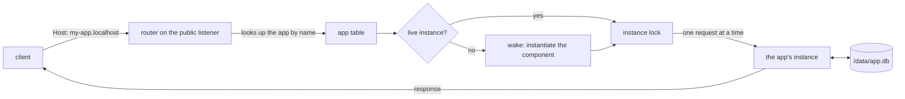

# How it works

After this page you will know what happens between `spared deploy` and a response. It is short on purpose. [docs/design.md](design.md) has the long version with measurements, and [AGENTS.md](../AGENTS.md) is the reference for flags, limits and error kinds. If you have not run anything yet, start with [getting started](getting-started.md).

spared is an early preview, so details here can change.

## An app is a crate compiled to a Wasm component

An app is an ordinary Rust crate with one HTTP handler. `spared test` and `spared deploy` compile it to a `wasm32-wasip2` component. SQLite is C code, and it is compiled into that same component, so the database engine runs inside the sandbox with your code.

```text
  your crate                          one file you deploy
 +-------------------------+        +------------------------------+
 | src/main.rs   (handler) |        |  Wasm component              |
 | src/spared.rs (helpers) | build  |   - your handler             |
 | Cargo.toml              +------->|   - rusqlite + SQLite (C)    |
 | spared.toml  (manifest) |        |   - wstd (HTTP types)        |
 +-------------------------+        +---------------+--------------+
                                                    |
                                      reads and writes /data/app.db
```

The component is a binary crate with `#[wstd::http_server]` on `async fn main`. It gets a request, returns a response, and keeps its state in one SQLite file. It is not given environment variables or secrets.

The manifest, `spared.toml`, travels with the app and says what it may use.

## The request path

One host process, `spared serve`, runs on one machine. It has two listeners. The public one (default `127.0.0.1:8080`) serves apps. The admin one (default `127.0.0.1:8081`) takes deploys, logs, backups and deletes, and needs a bearer token.



What the diagram means:

- **Routing is by hostname.** `my-app.localhost` goes to the app named `my-app`. With `--domain example.com`, `my-app.example.com` does too. Path routing (`/_/my-app/`) exists but is off by default, and it has a security cost covered below.
- **One live instance per app.** All requests for an app go through a single instance, guarded by a lock in the host. Requests to the same app run one after another. Different apps run at the same time.
- **Consequences.** Writes to one app are serialized, so SQLite needs no locking between processes. A slow request delays the app's other requests, up to its deadline. Anything the app keeps in memory lasts only until its instance is dropped, so treat memory as a cache.
- **Idle unload.** A background task checks every 500 ms and drops any instance that has been idle for about 30 seconds (`--idle-secs`, default 30). Dropping the instance releases the app's Wasm memory and open database, but not everything: the compiled component stays mapped, about 4.1 MiB for an app whose code differs from every other app's and about 0.09 MiB for a copy of a shared one. A deployed app nobody has requested since the server started costs about 0.67 MiB. The app's files stay on disk.
- **Wake time.** The next request after an unload wakes a fresh instance. On the test machine, instantiating the component took about 40 to 50 microseconds, and waking to a first query with the default journal took about 0.65 ms at p50 (in process, no network). Over HTTP on the same machine, the first byte of an idle app with data on disk took about 0.9 ms at p50 in the workerd comparison (0.7 ms in an earlier session, 1.1 ms in the first), with the app's compiled code in the OS page cache. That is a wake from idle, not a cold process start. After a reboot (cold page cache), the first request to each of 500 different apps took 5.4 ms at p50 with no read-ahead. With `--prefetch-mb 4096`, which covered their compiled code, it took 1.8 ms, and with the 1 GB default it took 3.3 ms (500 apps of 6.7 MiB, local virtio disk, one VM). These are from one 4 vCPU VM with a warm cache and small databases. See [benchmarks](benchmarks.md).
- **After a failure.** A trap, a CPU limit, a memory failure or a deadline drops the instance. The next request wakes a new one.

Because there is one instance and the app opens its database itself, the shipped helper uses SQLite's `unix-none` VFS (no lock files) and a rollback journal in `TRUNCATE` mode with `synchronous=FULL`. The first choice is safe only because the host guarantees one owner. See [design.md](design.md#sqlite-inside-the-sandbox) for why.

## Grants: what the manifest allows

A manifest has three parts.

```toml
name = "my-app"

[grants]
data = true                       # a /data directory (default true)
fetch = ["api.example.com"]       # outbound HTTP hosts (default none)

[limits]
memory_mb = 64
cpu_ms = 1000
deadline_ms = 5000
max_outbound = 10
```

The file may begin with `schema = 1`, the manifest format this spared reads; leaving it out means the same. A larger number is refused with `unsupported_schema` before any other key is looked at. `[secrets]` is a reserved name: spared has no secrets feature, so a manifest with that key is refused with `secrets_not_supported` instead of being accepted and ignored.

A Wasm component declares everything it wants from the host as imports. At deploy, and again whenever an app loads from disk, the host reads those imports and compares them with the manifest:

| Import | Allowed when |
|---|---|
| `wasi:cli`, `wasi:clocks`, `wasi:random`, `wasi:io`, `wasi:http/types` | always |
| `wasi:filesystem` | `data = true` |
| `wasi:http/outgoing-handler` | `fetch` is not empty |
| anything else, including every `wasi:sockets` interface | never |

If the component imports something the manifest does not grant, the deploy fails with `ungranted_import`, naming the import and, where one exists, the manifest line that would fix it. `spared test` runs the same check, so you find out before you deploy. The host also refuses a component that has no HTTP handler (`no_http_handler`), is not a component (`invalid_component`), is over 16 MB (`component_too_large`), is too expensive to compile (`component_too_complex`), or whose manifest `name` differs from the name being deployed (`name_mismatch`).

At run time, the app's filesystem is one directory mounted as `/data`. Outbound HTTP goes through a check: the host must be in `fetch` (`*.example.com` matches subdomains only, and an entry is a bare host name: one with a scheme, path, port or user name, a bare `*` or a private IP literal is refused at deploy with `bad_manifest`), the request must stay within `max_outbound` calls, and the host name must resolve to a public address. Private, loopback, link-local and cloud metadata addresses are refused even for a listed host. The [cookbook](cookbook.md#call-an-outside-api-with-a-fetch-grant) shows what a refusal looks like.

## Limits and operator caps

The app asks for limits in `[limits]`. The server operator sets maximums. An app can ask for less than the maximum and never more.

| Limit | What it bounds | App default | Server maximum (default) |
|---|---|---|---|
| `memory_mb` | the app's linear memory | 64 | 256 (`--max-memory-mb`) |
| `cpu_ms` | compute per request, counted in 1 ms ticks | 1000 | 5000 (`--max-cpu-ms`) |
| `deadline_ms` | wall-clock time per request | 5000 | 30000 (`--max-deadline-ms`) |
| `max_outbound` | outbound HTTP calls per request | 10 | 1000 (`--max-outbound`) |

Request bodies are capped at 8 MB and responses at 16 MB by default (`--max-request-mb`, `--max-response-mb`), and components at 16 MB (`--max-component-mb`). A deploy that asks for more than a maximum fails with `limit_too_high`. Why the operator caps exist: `spared.toml` is written by the same person who wrote the app, so it cannot be trusted to set its own ceiling.

When a limit is hit, the response says which one: `cpu_limit` (HTTP 508), `deadline` (HTTP 504), `memory_limit`. The CPU limit counts the wall-clock milliseconds the app's code runs, including the server's work inside its file and directory calls, not CPU time, so on a busy machine an app can be interrupted for work it did not do. Time spent waiting for the network or another app's turn is not counted, and `deadline_ms` bounds the whole request whatever it waits on or runs. Nobody outside the project has audited the sandbox.

The server also bounds what one app can ask of the machine outside its own memory. These are operator settings of the server, not manifest keys:

| What | Default | Flag | When it is reached |
|---|---|---|---|
| Data size under `/data` (each file counted at its apparent size, so a sparse file counts in full) | 1024 MB | `--max-app-data-mb` | a write that would grow the tree fails like a full disk: `ENOSPC` for the guest, `SQLITE_FULL` for SQLite |
| Files, directories and links under `/data` | 50,000 | `--max-app-entries` | creating another fails with a quota error; this also bounds the memory one directory listing can take |
| Directory listings open at once | 4 | none | the next `read_dir` fails with a quota error |
| Files and directories open at once, and streams on files (a stream keeps its own host descriptor even after the guest drops the file it came from, and counts until it is dropped) | 64 | `--max-app-fds` | the next open, or the next `read-via-stream`, `write-via-stream` or `append-via-stream`, fails with a quota error |
| Log bytes per request | 1024 KB | `--max-log-kb-per-request` | the rest of that request's output is dropped; the guest's write still succeeds and the log gets one `spared:` line saying so |
| Log bytes per second | 4096 KB | `--max-log-kb-per-sec` | the same |
| Largest component upload | 16 MB | `--max-component-mb` | `413 component_too_large` |
| Largest function in a component | 1024 KB of wasm, 2000 locals | `--max-function-kb`, `--max-function-locals` | `422 component_too_complex` |
| Compile memory (address space of the compile process) | 1024 MB | `--compile-memory-mb` | `422 component_too_complex` |
| Compile time | 60 s | `--compile-timeout-secs` | the compile process is killed; `422 component_too_complex` |
| Requests running or waiting per app | 16 | `--max-app-queue` | the next gets `503 app_busy` with `Retry-After: 1`; so does one that waits longer than the app's `deadline_ms` for its turn |
| Request body bytes held in memory, over all apps and connections | 64 MB (never below `--max-request-mb`) | `--max-body-buffer-mb` | the request gets `503 server_busy` with `Retry-After: 1` before its body is read; see [operating](operating.md#limits) |

The log file also rotates to `app.log.1` once it passes 4 MiB, so a hot app keeps at most two files. An app runs one instance at a time, so these figures are per app, not per instance. The server never takes an app's word that it freed space: a rename onto the same name, an unlink of a hard link or a truncate does not lower its count of the tree, and it counts the disk again before it refuses a write or a new entry (at most four times a second per app, so space an app really freed can still be refused for up to 250 ms), so only data the app really deleted comes back as room. A stream that is already open when the data size is reached fails with a generic I/O error, because a guest cannot see the error code of a failed stream write; streams that would extend a file are refused when they are opened, once less than 64 KiB are left. Backups and restores stop at the same size: a data tree whose files add up to more than `--max-app-data-mb` at apparent size is refused (`backup_failed`), and holes in sparse files stay holes in the copy.

## Deploy

```text
  spared deploy
       |
       v
  build the crate ----> upload component + spared.toml to the admin API
                                   |
                        validate everything first
                        (manifest, limits, imports, handler, size,
                        and that the host can link the component)
                                   |
                        precompile to native code
                                   |
                        hash the wasm (sha256)
                                   |
         +-------------------------+--------------------------+
         | components/<sha256>.cwasm already stored?          |
         |   yes: reuse it (component_reused)                 |
         |   no:  write it to a temp name, then rename        |
         +-------------------------+--------------------------+
                                   |
                        stage the new release as temp files, synced;
                        write the commit marker; rename them into place
                                   |
                        swap the new app into the app table,
                        drop the old instance
                                   |
                        data/ is untouched  (data_kept)
```

Points worth knowing:

- Validation happens before anything is written, so a bad deploy leaves the running version alone. That includes a component that parses and passes the import and handler checks but cannot be linked: it is refused with `invalid_component`, and the previous version keeps serving, also after a restart.
- Compiled components are stored once per distinct build in a shared store, named by the hash of the deployed wasm. Apps that deploy identical bytes share one file and one in-memory copy. Limits, grants and data stay per app.
- The swap is a lock-protected replacement in the app table. The old instance is stopped before the new one can serve, so two instances never open the same database.
- A deploy is committed by one step. The new manifest, hash, version and component links are written as `*.tmp` files in the app directory and synced, along with the stored component. Then the server creates `release.pending` (synced), which is the commit point, and renames the staged files into place. A crash before the marker leaves the previous version; a crash after it is completed at the next start, which renames whatever is still staged. A restart therefore never finds a new manifest next to an old component. What this relies on is the file system honoring `fsync` and `rename`; a power-loss test has not been run.
- Deploy, delete, backup, restore and evict run to the end once the server has the request, even if the client goes away (Ctrl-C, a proxy timeout, the CLI's own timeout). Each runs as its own task and holds the app's instance lock for the whole operation, so an abandoned backup is still a whole backup, an abandoned restore never lets a write land mid-swap, and an abandoned `spared rm` or redeploy does not leave the app half done. Only the wait for the answer is cancelled; check the result with `spared ps` or `spared backups`.
- To start from an empty database, run `spared rm <name> --yes` first.

## Stopping

`spared serve` stops gracefully on SIGTERM (`docker stop`, `systemctl stop`, a Fly or Railway deploy) and on SIGINT (Ctrl-C). It closes both listeners at once, lets the requests already running finish for up to 4 seconds, releases every app's instance, flushes its output and exits with status 0. Connections still busy when the 4 seconds are over are cut, and the exit status is still 0; the shutdown prints how many. A second signal during the shutdown exits immediately with status 128 plus the signal number. A signal while the server is still starting (loading apps, compiling the bundled examples) ends the start the same way.

This also holds as PID 1 in a container, where the kernel drops any signal the process has no handler for: the server installs its handlers first thing, and `deploy/entrypoint.sh` hands the process over with `exec`, so the server itself is PID 1 and receives the signal. An admin call that is still running when the grace period ends (a long backup, say) is cut like a crash would cut it: a partial backup is removed at the next backup, an interrupted restore is finished or undone at the next start, and a deploy is either committed or not (see Deploy).

## Where data lives

Everything is under the data directory you pass to `spared serve --data-dir` (default `.spared-data`; `spared dev` uses `./.spared`).

```text
<data-dir>/
  format.json               which on-disk layout this is, and which version last opened it
  admin-token               the admin bearer token (mode 0600)
  .lock                     held by the running server so a second one cannot open this directory
  components/
    <sha256>.cwasm          one compiled component per distinct build, shared
    <sha256>.wasm           the wasm it was compiled from, kept so it can be compiled again
  apps/
    <name>/
      component.cwasm       hard link into components/
      component.wasm        hard link into components/
      component.sha256      the store key
      manifest.toml         the app's spared.toml
      version               the deploy counter
      app.log               stdout and stderr, including panics
      data/
        app.db              the app's SQLite file, and anything else under /data
  backups/
    <name>/
      <UTC timestamp>/      a copy of data/ (for example 20261110T040506Z)
      pre-restore-<ts>/     the data a restore replaced
```

The server sets its umask to 077: directories are 0700 and files 0600, readable only by the user running the server. The app log is rotated to `app.log.1` when it passes 4 MiB while the app runs, and when an instance wakes with the log over 1 MiB, so a busy app keeps at most two files.

A backup copies one app's `data/` directory while its instance is stopped, hashes each file as it copies it and compares that with a read-back of the copy (the host never opens the database), and keeps the newest 20 per app by default (`--max-backups-per-app`). It does not hold code. Backups sit on the same disk, so they guard against bad writes and bad deploys, not against losing the disk, unless the server also uploads them to an S3-compatible bucket with `--backup-to` ([operating](operating.md#off-machine-backups)). The [getting started](getting-started.md#9-back-up-and-restore) guide shows the commands, and [AGENTS.md](../AGENTS.md#backups) has the details.

`format.json` is read before anything else at start. A server that does not understand the layout it names refuses to start, with `data_dir_too_new` or `data_dir_too_old` and a fix, instead of misreading the directory; a directory with no stamp is taken as the first layout and stamped. An upgrade never rewrites an app's `data/`. When a new release brings a new wasmtime, the compiled `.cwasm` files no longer load, and the server compiles each one again from the stored `.wasm` at start. [Upgrading](upgrading.md) has the steps and the full rule.

## What the operator sees

A short list is in [operating spared](operating.md).

`spared --version` prints the version and the commit the binary was built from. When `spared serve` starts it prints, on stderr, its version, the open-files limit, the data directory and its format, how many apps it loaded, both listen addresses and whether the access log is on. It never prints the admin token. The open-files line is there because every connection, app log and open data file costs a descriptor: the server raises its soft limit to the hard limit at start, warns when the limit is below what `--max-connections` needs, and when it still runs out it stops accepting for 100 ms at a time, logs the failure once every 5 seconds, and carries on as descriptors free up. One descriptor is held back for the admin listener, which uses it to accept a connection when the process has none left, so an operator can still reach the server. An app may hold at most `--max-app-fds` files open (default 64), so one app cannot use them all.

```text
spared 0.0.1-preview (1a2b3c4d5e6f) starting
open files: limit 1048576 (was 1024)
data dir: /srv/spared/data (format 1), 3 apps loaded
apps:  http://127.0.0.1:8080 (hosts <app>.localhost; health check: GET /healthz)
admin: http://127.0.0.1:8081 (needs the bearer token; metrics: GET /metrics)
access log: on, one JSON line per request on stdout (--access-log off to stop it)
```

After that there are three things to watch:

- **The request log**, on stdout. One JSON line per request:

  ```json
  {"time":"2026-11-10T04:05:06.123Z","listener":"public","app":"my-app","method":"POST","path":"/api/notes","status":201,"duration_ms":1.42,"request_id":"13fd38d1092f0b35"}
  ```

  A response that spared produced itself, rather than the app, also carries `"error"` with the error kind, such as `app_trap` or `deadline`. The line never includes the query string, any header or cookie, or the body, so tokens in URLs and form posts stay out of your logs. The same `request_id` goes back to the client in the `x-spared-request-id` header. Turn the log off with `--access-log off`.
- **The health check**: `GET /healthz` on the public listener answers 200 with `{"status":"ok","version":"...","uptime_seconds":N}`. Point a load balancer, Fly or Railway at it. It is answered only for a host that names no app, so it cannot shadow an app's own `/healthz`, and it says nothing about which apps exist.
- **Metrics**: `GET /metrics` on the admin listener, in the Prometheus text format, behind the same token, `Host` and `Origin` checks as the rest of the admin API. It is not on the public listener.

  ```sh
  curl -H "Authorization: Bearer $(cat ./data/admin-token)" http://127.0.0.1:8081/metrics
  ```

  It has requests by listener and status class, errors by kind, wakes, evictions by reason, apps deployed and hot, loaded components, bytes read ahead into the page cache (`spared_prefetch_bytes_total`) and the process's resident memory. Per-app numbers are in `spared ps`, not in the metrics. This is a metrics endpoint, not OpenTelemetry: there are no traces and nothing is pushed anywhere.

What each app prints is separate: `spared logs <name>` shows that app's stdout and stderr, including panics. The field list and the metric names are in [design.md](design.md#observability).

## The sandbox, in one paragraph

An app can reach its own `/data` directory, the clock, random numbers, and outbound HTTP to the hosts it lists. It cannot see other apps' files, the host's files or environment, raw sockets, DNS, or any address on a private, loopback, link-local or metadata range, and it cannot use more memory, compute, time or outbound calls than its limits allow. The host enforces this with wasmtime 50.0.1 plus its own checks. A 50-case escape suite (43 attacks, all denied, and 7 controls that had to succeed) and a server integration test cover it. Nobody outside the project has audited it, and a bug in wasmtime would defeat it. Known gaps include no cap on the total CPU time, disk bandwidth or network traffic an app uses across requests (the limits above bound one request, or the size of one app's stored data), so one app can still slow the others, and an app that can fetch a host resolving to the server's own public address can reach services listening there. The server's admin API is the other trust boundary, so keep it on loopback. Path routing puts every app on one browser origin, so apps could read each other's data in a visitor's browser. Leave it off for apps you did not write.

## The honest cost

SQLite runs inside the sandbox, which is what makes a hostile app's SQLite bugs stay inside that app. The price is speed. Against SQLite running natively on the host:

- A request with 10 reads and 1 durable write took about 0.33 ms longer at p50 (1.13 ms against 0.80 ms) and used 2.05 times the CPU. One core serves about half as many write-carrying requests.
- Across six query shapes, SQLite compiled to Wasm ran at about 1.85 times native CPU, from 1.07 times (durable inserts) to 2.4 times (point select). Epoch checks for the CPU limit are part of that. It was 3.2 times before SQLite was built with `pread`/`pwrite`, because SQLite on WASI sent every page through a WASI stream that crossed threads; it is now built with `pread`/`pwrite`.
- Memory: apps deployed from identical bytes share one compiled copy, and a hot app adds about 0.28 MiB. Apps with different code cannot share: each maps its own compiled SQLite and code, about 4.4 MiB of physical memory per hot app, 88 percent of it file-backed pages the kernel can reclaim. An idle different app keeps about 4.1 MiB of that mapped. Against workerd, measured as totals, spared uses less up to about 20 different apps and workerd uses less physical memory beyond that (889 MiB against 574 MiB at 200). spared uses less memory that cannot be reclaimed at every count, but in a cgroup, which counts page cache, it used 1.84x workerd's at 200 apps. So many different apps cost more memory than many copies of one (`docs/memory-methodology.md`).

These are single-machine, loopback measurements. Methods, results and caveats for every benchmark are in [benchmarks](benchmarks.md). If you trust every app you host, SQLite on the host is faster. spared makes this trade because it is meant to host code nobody reviewed.

## Not built

- Point-in-time restore. You can go back to a backup you took, not to an arbitrary moment.
- Scheduled backups and retention in the bucket. Backups can be uploaded to an S3-compatible bucket ([operating](operating.md#off-machine-backups)), but nothing runs them on a schedule or deletes old ones there.
- Failover. `spared move` moves an app to another server while both are up ([operating](operating.md#move-an-app-to-another-server)). Nothing moves one off a server that is down.
- Multi-node. It is one process on one machine.
- WebSockets.
- Cron and scheduled jobs.
- Per-app disk quotas set in `spared.toml`. The data size cap (`--max-app-data-mb`) is an operator setting that applies to every app alike.
- Browser sync.
- TLS and users on the admin API. It uses one shared bearer token over plain HTTP.
- Tracing and OpenTelemetry. There is a request log, a health check and a metrics endpoint.

Whether it is ready for production: [FAQ](faq.md#is-it-production-ready). Next: [cookbook](cookbook.md) for working code, [FAQ](faq.md) for direct answers.
